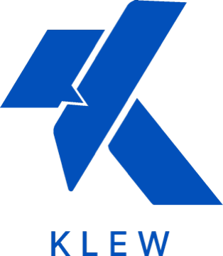
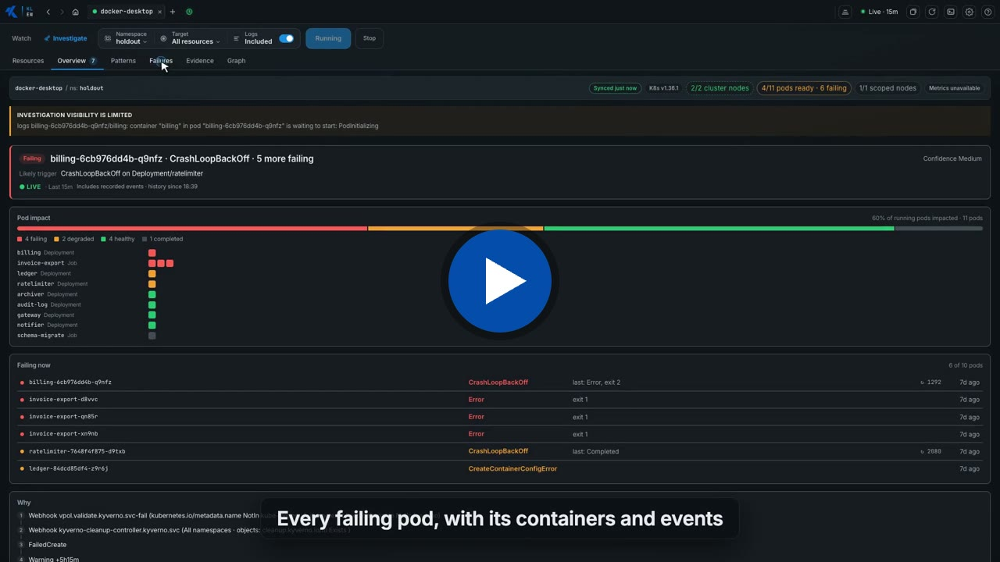

<p align="center">
  
</p>

[](https://github.com/glnreddy421/klew/releases/latest)
[](https://github.com/glnreddy421/klew/actions/workflows/tests.yml)
[](https://github.com/glnreddy421/klew/actions/workflows/tests.yml)
[](go.mod)
[](LICENSE)
[](https://github.com/glnreddy421/klew/actions/workflows/sca.yml)
[](https://github.com/glnreddy421/klew/actions/workflows/sast.yml)
[](https://github.com/glnreddy421/klew/actions/workflows/github-code-scanning/codeql)
[](SECURITY.md#supply-chain)
[](SECURITY.md#supply-chain)

**Live Kubernetes incident investigation: a macOS app, a CLI, and an MCP server on one read-only engine.**

When something breaks in a cluster you need three answers fast: **what failed**, **why**, and **what else is affected**. Klew discovers the related objects, watches live state, events, and logs, correlates them, and keeps one investigation up to date as the cluster changes — instead of a dozen `kubectl` commands across terminal tabs.

<p align="center">
  <a href="https://klew-ui.web.app/videos/klew-tour.mp4"></a>
  <br>
  <sub><a href="https://klew-ui.web.app/videos/klew-tour.mp4">Watch the 3-minute tour</a>: resources, live logs, investigate, CLI and MCP.</sub>
</p>

## Contents

- [Get started](#get-started)
- [What you get](#what-you-get)
- [Install](#install)
  - [Desktop app (macOS 12+)](#desktop-app-macos-12)
  - [`klew` command (macOS and Linux)](#klew-command-macos-and-linux)
  - [Verify a download](#verify-a-download)
- [Desktop app](#desktop-app)
  - [Keyboard shortcuts](#keyboard-shortcuts)
- [Command line](#command-line)
  - [In scripts and CI](#in-scripts-and-ci)
- [MCP server](#mcp-server)
  - [Tools](#tools)
- [Extensions](#extensions)
- [Security and privacy](#security-and-privacy)
- [Development](#development)
  - [Tests](#tests)
  - [Layout](#layout)
- [Contributing](#contributing)
- [License](#license)

## Get started

```bash
# Desktop app (macOS)
brew tap glnreddy421/klew
brew install --cask klew

# klew command: CLI and MCP server (macOS, Linux)
brew install glnreddy421/klew/klew-cli
```

```bash
klew investigate -n shop                        # investigate a namespace
klew investigate -n shop checkout               # or one workload in it
claude mcp add --scope user klew -- klew mcp    # give the same engine to an AI assistant
```

All you need is a working kubeconfig (`~/.kube/config` or `KUBECONFIG`). Klew acts with that context's RBAC and **never changes your cluster**: it only lists, gets, and watches.

| Front end | Runs on | Use it for |
| --- | --- | --- |
| [Desktop app](#desktop-app) | macOS 12+ (Apple Silicon, Intel) | The full UI: resource browser, investigation tabs, graph, live logs, terminal |
| [`klew investigate`](#command-line) | macOS, Linux (arm64, amd64) | A report in the terminal, JSON for scripts, exit codes for CI |
| [`klew mcp`](#mcp-server) | macOS, Linux (arm64, amd64) | Verdicts and cluster lookups for Claude Code, Claude Desktop, Cursor, and other MCP clients |

## What you get

- **A verdict, not a dump** — status, leading signal, causal chain, confidence, and next steps for the workload you're investigating.
- **Failures ranked by severity** — pod triage with container state, exit codes, limits, and related events.
- **Patterns** — log and event templates mined from every pod in scope, with recurring and emerging behavior.
- **Evidence** — infrastructure events linked to log templates by co-movement or failure coverage, plus the observations behind each claim.
- **Resources** — a full read-only cluster catalog with a live inspector, connection trace, and manifest view. Works without an investigation.
- **Graph** — ingress → service → workload → pod relationships, colored by health.
- **Event history** — Kubernetes keeps Events for about an hour; Klew records them locally while it runs, so you can see what happened before you started looking.
- **Live logs** — select pods, workloads or Services and stream their logs together, stern-style: one merged, time-ordered stream with a colour per pod. Workloads follow their selector, so new pods join. Works with or without an investigation.
- **Built in** — cluster terminal pinned to the active context, and one window per cluster.
- **Extensible** — add your own checks as YAML and CEL; they apply in all three front ends. See [Extensions](#extensions).

## Install

### Desktop app (macOS 12+)

**Homebrew**

```bash
brew tap glnreddy421/klew
brew install --cask klew
```

Upgrade with `brew update && brew upgrade --cask klew`; remove with `brew uninstall --cask klew`.

<details>
<summary>Migrating from the old formula</summary>

If you installed with `brew install klew` (no `--cask`), switch once:

```bash
brew uninstall klew
brew install --cask klew
```

</details>

**Download**

Grab the DMG from [Releases](https://github.com/glnreddy421/klew/releases) — `Klew-x.y.z-macos-arm64.dmg` for Apple Silicon, `Klew-x.y.z-macos-amd64.dmg` for Intel — and drag **Klew** to Applications.

### `klew` command (macOS and Linux)

One binary provides both `klew investigate` and `klew mcp`. It does not need the desktop app.

```bash
brew install glnreddy421/klew/klew-cli                             # Homebrew; upgrade with: brew upgrade klew-cli
go install github.com/glnreddy421/klew/v2/cmd/klew@latest          # or from source, Go 1.26+
```

Every release also has signed `klew-cli-x.y.z-<os>-<arch>.tar.gz` archives for machines without Homebrew. See [docs/mcp.md](docs/mcp.md#other-ways).

### Verify a download

Each release has an SPDX SBOM, a `SHA256SUMS` file, and signed build provenance. To check that a download was built by this repository's release workflow:

```bash
gh attestation verify Klew-x.y.z-macos-arm64.dmg --repo glnreddy421/klew          # desktop app
gh attestation verify klew-cli-x.y.z-darwin-arm64.tar.gz --repo glnreddy421/klew   # klew command
shasum -a 256 -c --ignore-missing Klew-x.y.z-SHA256SUMS.txt                        # checksums of what you downloaded
```

## Desktop app

Everything happens on **Resources**, which has two modes.

**Watch** — browse the cluster.

1. Pick a context in the top bar and namespaces in the Resources toolbar.
2. Choose a category and select a row.
3. The inspector loads live details, the connection trace, and the manifest.

**Investigate** — find out what is wrong.

1. Switch to **Investigate** (⌘K) and pick one namespace.
2. Optionally pick a **Target**: **All resources** in the namespace, or any resources in it (searchable, grouped by type). Untick **Logs** to investigate without reading container logs.
3. Click **Investigate**. The results open as tabs on the same screen (**Overview, Patterns, Failures, Evidence, Graph**) and update as signals arrive.

You can also select any resource in the table and click **Investigate** in the inspector to investigate exactly that object. Switch back to **Watch** to keep browsing; the investigation keeps running until you click **Stop**.

> **The namespace is the boundary.** Klew investigates workloads inside the selected namespace.

### Keyboard shortcuts

| Shortcut | Action |
| --- | --- |
| ⌘K | Investigate mode |
| ⌘R | Refresh the investigation, or sync kubeconfig when idle |
| ⌘N | New window (another cluster) |
| ⌘, | Settings |
| ⌘\` | Terminal |
| ⌘⇧L | Stream logs from the selected resources (or open Live logs) |

## Command line

`klew investigate` prints what the desktop app shows in Overview, Failures, Patterns and Evidence (no graph), on macOS and Linux, without the desktop app.

```bash
klew investigate -n shop                    # the whole namespace
klew investigate -n shop checkout           # one workload: api, deploy/api, pod/api-7f9c
klew investigate -n shop -only failures     # just the pod triage
klew investigate -n shop -o json            # every field, for scripts
klew investigate -n shop -no-logs           # do not read container logs
```

Example output:

```text
shop / api  context kind-shop · collected 05:00:00 · watched 10s

CRITICAL  CrashLoopBackOff  confidence 82% (High)
api containers are crash-looping after a new revision.
Pods: 1 ready, 2 unready, 10 restarts

OVERVIEW
  Problems
    critical Deployment/api  CrashLoopBackOff
             2 of 3 pods unready
  What Klew connected
    1. Revision 7 rolled out
    2. Containers exit 1 at start
    3. Pods enter CrashLoopBackOff

FAILURES
  2 of 3 pods failing

  api-2  CrashLoopBackOff · not ready · 7 restarts · node-1
    container app: waiting (CrashLoopBackOff) · last Error exit 1 · 7 restarts · shop/api:2
    Nov 07 04:59:00  BackOff Back-off restarting failed container

  api-3  CrashLoopBackOff · not ready · 3 restarts · node-1
    container app: waiting (CrashLoopBackOff) · last Error exit 1 · 3 restarts · shop/api:2

PATTERNS
  Log patterns
    ↑    42×  61%  dial tcp <*>:5432: connect: connection refused
              pods: api-2, api-3
              e.g. dial tcp 10.0.0.5:5432: connect: connection refused
  Event patterns
    ·     9× 100%  Back-off restarting failed container

EVIDENCE
  Correlated (event ↔ logs)
     90%  Back-off restarting failed container
          → dial tcp <*>:5432: connect: connection refused
  Claims
    strong CrashLoopBackOff ×7
           7 restarts in 5m
    weak   Probe failures
  Observations
    Nov 07 04:57:00  Change Deployment/api ImageChanged shop/api:1 → shop/api:2
  Not checked
    ingresses: no-permission — forbidden
  Gaps
    - metrics-server not installed
  Next checks
    1. kubectl logs deploy/api --previous
```

Suggested actions are text. Klew never runs them.

### In scripts and CI

| Exit status | Meaning |
| --- | --- |
| 0 | Healthy (or not enough data to say otherwise) |
| 1 | Error, such as no cluster access or a missing namespace |
| 2 | Usage error |
| 3 | Warning |
| 4 | Critical |

```bash
klew investigate -n shop -observe 0s -only overview || echo "shop needs attention"
klew investigate -n shop -o json | jq -r '.overview.problems[] | "\(.severity) \(.object) \(.state)"'
```

Output is **not redacted**: log lines and event messages appear as they are, like `kubectl logs`. Review it before sharing. Secret values are never read or shown.

Every option and report section is in [docs/cli.md](docs/cli.md), or run `klew investigate -h`.

## MCP server

`klew mcp` gives AI assistants Klew's analysis over the [Model Context Protocol](https://modelcontextprotocol.io) instead of raw `kubectl` output. It is read-only, runs locally over stdio, and works without the desktop app.

**Claude Code**

```bash
claude mcp add --scope user klew -- klew mcp
```

**Claude Desktop, Cursor, and other JSON-configured clients**

```json
{
  "mcpServers": {
    "klew": {
      "command": "klew",
      "args": ["mcp"]
    }
  }
}
```

If the client cannot find `klew`, use the full path that `command -v klew` prints. Desktop app users need no separate install: **Set up MCP** on the Home screen shows a ready-to-copy configuration for the server built into the app.

Then ask things like:

- "Why is payment-api failing in klew-lab?"
- "What changed in payment-api before it started crashing?"
- "Show warning events for redis over the last two days."

### Tools

| Tool | Returns |
| --- | --- |
| `klew_investigate` | A verdict for a namespace or workload: status, leading signal, causal chain, problems, failing pods, top patterns, next checks |
| `klew_investigation_details` | One section of an earlier investigation, paged, with no new cluster calls |
| `klew_event_history` | Events for a namespace or object, live ones merged with those the desktop app recorded |
| `klew_workload_changes` | Revision history of a Deployment, StatefulSet, DaemonSet or Helm release, with field-level diffs |
| `klew_list_resources` | Objects of any type the cluster serves, custom resources included, like `kubectl get` |
| `klew_get_resource` | One object: summary, labels, owners, conditions, container state. Secrets show key names and sizes only |
| `klew_pod_logs` | Recent log lines of one container, redacted. Not offered with `-no-log-samples` |
| `klew_list_contexts` | Contexts in your kubeconfig |

Every tool is annotated `readOnlyHint: true` and `destructiveHint: false`, and none runs `kubectl` or a shell.

> [!IMPORTANT]
> **Where your data goes.** `klew mcp` runs on your machine and sends nothing anywhere itself. But tool results — object names, event messages, object summaries, and container log lines — become part of the conversation, which your MCP client sends to its AI provider (Anthropic, OpenAI, …). `klew mcp` masks common credential shapes and email addresses first, **on a best-effort basis: it can miss sensitive values your applications log.** Run it with `-no-log-samples` to leave raw log text out (generalised log patterns are still sent; see [docs/mcp.md](docs/mcp.md#-no-log-samples)), and only connect it to clusters whose data you are allowed to share with your provider.

Flags, client setup, and data handling are in [docs/mcp.md](docs/mcp.md).

## Extensions

Add your own checks as YAML: a **collector** lists a resource type, and a **rule** tests each object with a [CEL](https://cel.dev) expression. No rebuild is needed, and they apply in the desktop app, `klew investigate` and `klew mcp`.

```yaml
apiVersion: klew.dev/v1alpha1
kind: Collector
metadata:
  name: certificates
spec:
  group: cert-manager.io
  resource: certificates
---
apiVersion: klew.dev/v1alpha1
kind: Rule
metadata:
  name: certificate-not-ready
spec:
  resource: certificates
  when: "object.status.conditions.exists(c, c.type == 'Ready' && c.status != 'True')"
  severity: high
  state: CertificateNotReady
  facts:
    - "object.status.conditions.filter(c, c.type == 'Ready')[0].message"
```

Check and test rules before relying on them. Both commands are read-only:

```bash
klew mcp -check-extensions                                   # what loaded, and every problem
klew mcp -dry-run certificate-not-ready -namespace shop      # what one rule matches, read live
```

Where extensions live, the built-in collectors and rules, and how findings affect the verdict are in [docs/extensions.md](docs/extensions.md).

## Security and privacy

- **Read-only.** Klew lists, gets, and watches. It has no code path that creates, updates, patches, scales, execs into, or deletes anything, and it never runs the commands it suggests. The desktop app's terminal is an ordinary shell that you drive.
- **Your RBAC.** Klew sees only what your kubeconfig credentials can. Anything it could not check is reported as not checked, not as healthy.
- **No Secret values.** Secrets appear as type, key names, and sizes only.
- **No telemetry and no account.** Klew connects to the Kubernetes API servers in your kubeconfig (through your proxy settings, if any). Other network use is limited to downloading a version-matched `kubectl` from `dl.k8s.io` when your cluster needs one, fetching UI fonts from Google Fonts (cached locally), and the desktop app checking GitHub's releases API for a newer version shortly after launch and from **Check for updates**. That check sends only a `Klew/<version>` user agent, nothing about you or your clusters. `klew mcp` makes none of these calls.
- **Local history.** Recorded event history stays on your Mac in `~/Library/Application Support/Klew/history/` and is never uploaded. Turn it off or clear it in **Settings → Investigation**.

The full security model, supply-chain details, and how to report a vulnerability are in [SECURITY.md](SECURITY.md).

## Development

Requires Go 1.26+. The desktop app also needs Node 24 and [Wails v2](https://wails.io).

```bash
git clone https://github.com/glnreddy421/klew.git
cd klew

# klew command (CLI and MCP server)
go build -o klew ./cmd/klew
./klew investigate -n default

# Desktop app, with live reload
go install github.com/wailsapp/wails/v2/cmd/wails@latest
cd cmd/klew-desktop
wails dev
```

### Tests

```bash
# Engine and klew command (macOS and Linux)
go vet ./internal/... ./cmd/klew/... ./cmd/klew-stress/...
go test -race -count=1 ./internal/... ./cmd/klew/... ./cmd/klew-stress/...

# Desktop UI
cd cmd/klew-desktop/frontend
npm ci
npm test
npm run build
```

`go test ./...` also covers the desktop app, which embeds `cmd/klew-desktop/frontend/dist`, so build the frontend first.

Pull requests run these plus `gofmt`, `go mod tidy -diff`, `golangci-lint` (with `gosec`), `govulncheck`, Trivy, CodeQL, and `npm audit`.

### Layout

```text
cmd/klew               klew command: investigate, mcp
cmd/klew-desktop       macOS app (Wails); React UI in frontend/
cmd/klew-stress        in-process engine load tests, no cluster needed
internal/engine        investigation engine: collectors, rules, correlation, incidents
internal/kube          cluster access and the resource catalog
internal/logpatterns   log and event template mining
internal/changes       workload revision history and field-level diffs
internal/history       local record of Kubernetes Events
internal/cli           klew investigate: report and printer
internal/mcpserver     MCP tools and result shaping
internal/redact        masking of credentials and personal data
tools/k8s-log-engine   log parsing and keyword extraction tool (separate Go module)
docs/                  CLI, MCP, and extensions guides
```

Release builds use `.github/scripts/build-macos.sh` and `.github/scripts/build-cli.sh`. See [CHANGELOG.md](CHANGELOG.md) for what's new.

## Contributing

Bug reports, ideas, and pull requests are welcome. [CONTRIBUTING.md](CONTRIBUTING.md) covers how to report a problem, the read-only rules every change must keep, and the checks a pull request has to pass. Everyone taking part is expected to follow the [Code of Conduct](CODE_OF_CONDUCT.md).

Report security problems privately, as described in [SECURITY.md](SECURITY.md).

## License

Apache 2.0 — see [LICENSE](LICENSE).
