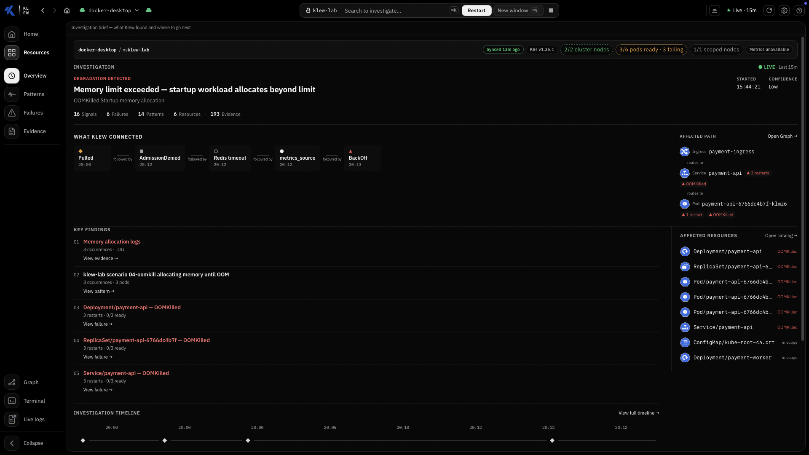
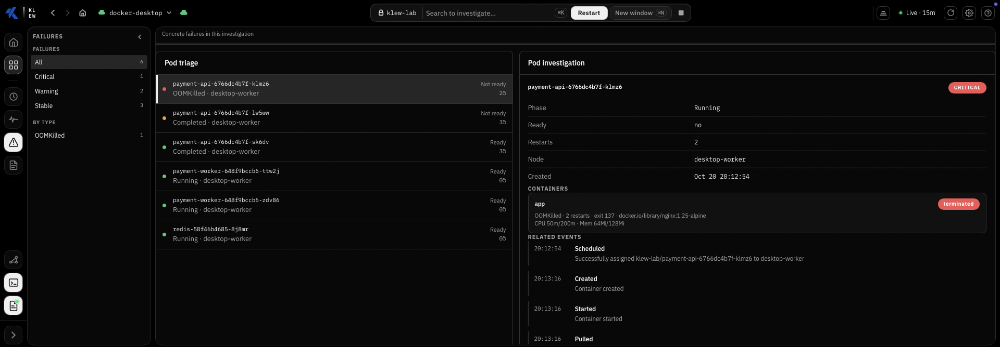
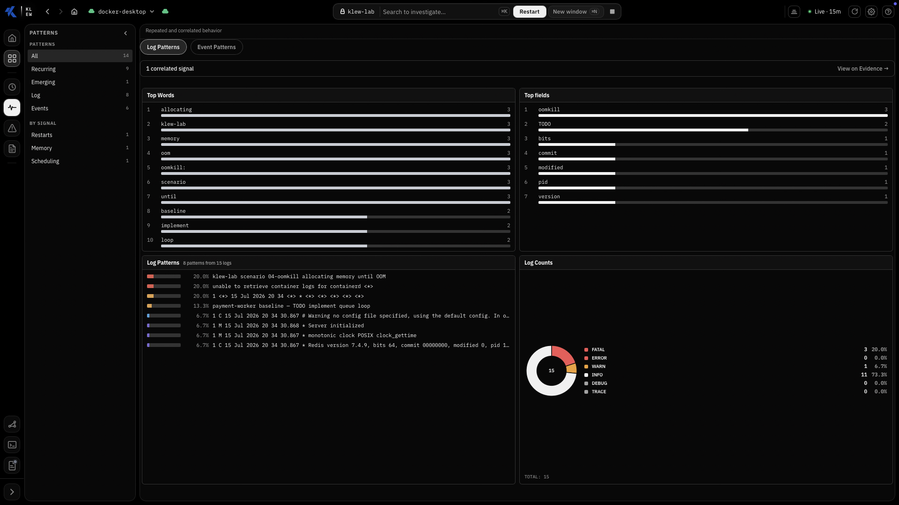
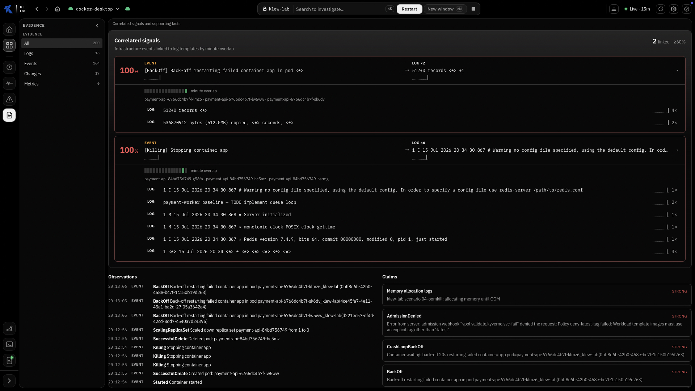
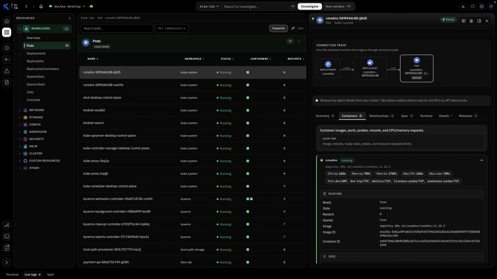
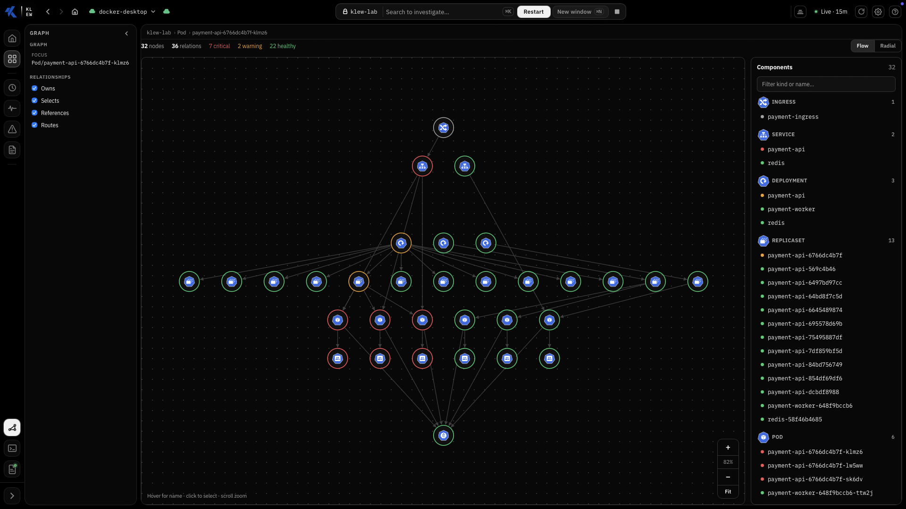

# Klew

[](https://github.com/glnreddy421/klew/actions/workflows/tests.yml)
[](https://github.com/glnreddy421/klew/actions/workflows/tests.yml)
[](https://github.com/glnreddy421/klew/actions/workflows/sca.yml)
[](https://github.com/glnreddy421/klew/actions/workflows/sast.yml)
[](https://github.com/glnreddy421/klew/actions/workflows/github-code-scanning/codeql)
[](https://github.com/glnreddy421/klew/releases/latest)
[](SECURITY.md#supply-chain)
[](SECURITY.md#supply-chain)
[](go.mod)
[](LICENSE)

**Live Kubernetes incident investigation for macOS.**

When something breaks in a cluster you need three answers fast: **what failed**, **why**, and **what else is affected**. Klew discovers the related objects, watches live state, events, and logs, correlates them, and keeps one investigation up to date as the cluster changes — instead of a dozen `kubectl` commands across terminal tabs.



## What you get

- **A verdict, not a dump** — status, leading signal, causal chain, confidence, and next steps for the workload you're investigating.
- **Failures ranked by severity** — pod triage with container state, exit codes, limits, and related events.
- **Patterns** — log and event templates mined from every pod in scope, with recurring and emerging behavior.
- **Evidence** — infrastructure events linked to log templates by time overlap, plus the observations behind each claim.
- **Resources** — a full read-only cluster catalog with a live inspector, connection trace, and manifest view. Works without an investigation.
- **Graph** — ingress → service → workload → pod relationships, colored by health.
- **Event history** — Kubernetes keeps Events for about an hour; Klew records them locally while it runs, so you can see what happened before you started looking.
- **Built in** — cluster terminal pinned to the active context, multi-pod live logs, and one window per cluster.

Klew is **read-only**: it lists and watches resources and never changes your cluster.

## Screenshots

| Failures | Patterns |
| --- | --- |
|  |  |
| **Evidence** | **Resources** |
|  |  |



## Install

**Requires** macOS 12+ and a working kubeconfig (`~/.kube/config`, or `KUBECONFIG` from your shell profile).

### Homebrew

```bash
brew tap glnreddy421/klew
brew install --cask klew
```

Upgrade with `brew update && brew upgrade --cask klew`; remove with `brew uninstall --cask klew`.

<details>
<summary>Migrating from the old formula</summary>

If you installed with `brew install klew` (no `--cask`), switch once:

```bash
brew uninstall klew
brew install --cask klew
```

</details>

### Download

Grab the DMG from [Releases](https://github.com/glnreddy421/klew/releases) — `Klew-x.y.z-macos-arm64.dmg` for Apple Silicon, `Klew-x.y.z-macos-amd64.dmg` for Intel — and drag **Klew** to Applications.

Each release also has an SPDX SBOM, a `SHA256SUMS` file, and signed build provenance. To check that a download was built by this repository's release workflow:

```bash
gh attestation verify Klew-x.y.z-macos-arm64.dmg --repo glnreddy421/klew          # desktop app
gh attestation verify klew-mcp-x.y.z-darwin-arm64.tar.gz --repo glnreddy421/klew   # MCP server
shasum -a 256 -c --ignore-missing Klew-x.y.z-SHA256SUMS.txt                        # checksums of what you downloaded
```

## Quick start

**Browse** — pick a context and namespace in the top bar, open **Resources**, choose a category, and select a row. The inspector loads live details, the connection trace, and the manifest.

**Investigate** — set a single namespace, optionally search for a workload, and click **Investigate**. Move through **Overview → Failures → Patterns → Evidence** as signals arrive.

> **The namespace is the boundary.** Klew investigates workloads inside the selected namespace. Overview, Failures, Patterns, Evidence, and Graph need an active investigation; Resources does not.

## Keyboard shortcuts

| Shortcut | Action |
| --- | --- |
| ⌘K | Focus search |
| ⌘R | Refresh the investigation, or sync kubeconfig when idle |
| ⌘N | New window (another cluster) |
| ⌘, | Settings |
| ⌘\` | Terminal |
| ⌘⇧L | Live logs |
| ⌘⇧\` | Split terminal and logs |

## MCP server

`klew-mcp` gives AI assistants (Claude Code, Claude Desktop, Cursor, …) Klew's verdicts, failure triage, patterns, event history and workload changes over the Model Context Protocol. It is read-only, runs without the desktop app, and works on macOS and Linux.

```bash
go install github.com/glnreddy421/klew/cmd/klew-mcp@latest   # or download a signed binary from Releases
claude mcp add klew -- klew-mcp
```

**Where your data goes.** `klew-mcp` runs on your machine and sends nothing anywhere itself. But tool results — object names, event messages, and samples of container log lines — become part of the conversation, which your MCP client sends to its AI provider (Anthropic, OpenAI, …). `klew-mcp` masks common credential shapes and email addresses first, **on a best-effort basis: it can miss sensitive values your applications log.** Run it with `-no-log-samples` to never send raw log lines, and only connect it to clusters whose data you are allowed to share with your provider.

See [docs/mcp.md](docs/mcp.md) for tools, client setup, and data handling, and [SECURITY.md](SECURITY.md) for the security model.

## Privacy

No telemetry and no account. Klew connects to the Kubernetes API servers in your kubeconfig (through your proxy settings, if any). Other network use is limited to downloading a version-matched `kubectl` from `dl.k8s.io` when your cluster needs one, and fetching UI fonts from Google Fonts (cached locally).

Recorded event history stays on your Mac in `~/Library/Application Support/Klew/history/` and is never uploaded. Turn it off or clear it in **Settings → Investigation**.

## Build from source

Requires Go 1.26+, Node 24, and [Wails v2](https://wails.io).

```bash
git clone https://github.com/glnreddy421/klew.git
cd klew/cmd/klew-desktop
wails dev
```

Release builds use `.github/scripts/build-macos.sh`. See [CHANGELOG.md](CHANGELOG.md) for what's new.

## License

Apache 2.0 — see [LICENSE](LICENSE).
